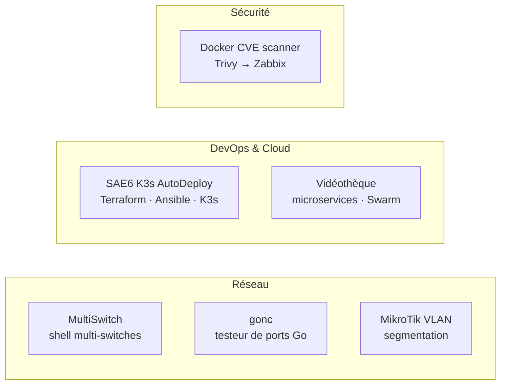

# Loïc Maurer

**Master Informatique · Réseaux, automatisation & DevOps · Administrateur réseau chez FM Logistic**

---

## 👋 À propos

Étudiant en **Master Informatique** à l'Université de Reims Champagne-Ardenne, après un **BUT Réseaux & Télécommunications** (parcours DevCloud) à l'IUT de Colmar.  
Administrateur réseau **WAN/LAN & automatisation** chez **FM Logistic** : support N2/N3, SD-WAN, automatisation Ansible/Python.

J'aime construire les outils dont j'ai besoin au quotidien : shells réseau, scanners, pipelines de déploiement. Le reste du temps : CTF et homelab.

- 🔐 **CTF** : TryHackMe · Root-Me · pwn, forensics, crypto, réseau
- 🌐 **Portfolio** : [id00l.eu](https://id00l.eu)
- 📍 Grand Est, France

---

## 🛠️ Stack technique

**Langages**

**Frameworks & Outils**

**Réseau & Sécurité**

---

## 🔐 Cybersécurité & CTF

| Catégorie | Compétences |
|---|---|
| Binary Exploitation | Buffer overflow, heap tcache/UAF, pwntools |
| Forensics | Volatility3 (Windows RAM dump), pcap (tshark / tcpflow) |
| Réseau | ARP spoofing, MITM, extraction credentials FTP |
| Cryptographie | RSA, Base64, ROT13, zip cracking, brute-force TCP oracle |
| Blockchain | Lecture storage Ethereum Sepolia (eth_getStorageAt) |

---

## 📡 Réseau & Infrastructure

| Domaine | Technos & Protocoles |
|---|---|
| Switching / Routing | Cisco IOL, MikroTik RouterOS, OSPF, BGP, VLAN, STP, ACL |
| SD-WAN | Forcepoint SD-WAN, migration Netscope |
| Automatisation | Ansible, Python, Shell scripting |
| Virtualisation | VMware, VirtualBox, Vagrant, Docker |
| IoT / Embarqué | Raspberry Pi Pico W, e-ink Waveshare, MicroPython, SPI |

---

## 🧪 Projets

<table>
<tr>
<td width="50%" valign="top">

### 🖧 [MultiSwitch](https://github.com/LOIC-only-one/MultiSwitch)
Shell Python qui pilote plusieurs switches en parallèle (SSH Netmiko), avec provisioning Aruba depuis un profil JSON et un lab Docker pour tester sans matériel.  
`Python` · `Netmiko` · `Rich` · `Aruba`

</td>
<td width="50%" valign="top">

### ☸️ [SAE6 · K3s AutoDeploy](https://github.com/LOIC-only-one/SAE6-K3s-AutoDeploy)
Proxmox → Terraform → Ansible → GitLab + K3s : CI/CD sur trois environnements, Prometheus/Grafana, Velero et Chaos Mesh.  
`Terraform` · `Ansible` · `K3s` · `GitLab CI`

</td>
</tr>
<tr>
<td width="50%" valign="top">

### 🎬 [Vidéothèque microservices](https://github.com/LOIC-only-one/projet-m705-serveur)
Trois API Flask (auth JWT RS256, utilisateurs, catalogue), MongoDB, Caddy, déploiement Docker Swarm via GitHub Actions → GHCR. [Front-end](https://github.com/LOIC-only-one/projet-m705-client).  
`APIFlask` · `MongoDB` · `JWT` · `Swarm`

</td>
<td width="50%" valign="top">

### 🛡️ [Docker CVE → Zabbix](https://github.com/LOIC-only-one/Script-Image-Scanner-Docker-zabbix)
Scanne toutes les images en service avec Trivy et remonte les vulnérabilités par sévérité dans Zabbix, avec alertes.  
`Python` · `Trivy` · `Zabbix` · `Docker`

</td>
</tr>
<tr>
<td width="50%" valign="top">

### 🔌 [gonc](https://github.com/LOIC-only-one/gonc)
Testeur de ports TCP/UDP en Go, parallèle, avec mode écoute pour valider un flux à travers un pare-feu.  
`Go` · `TCP/UDP`

</td>
<td width="50%" valign="top">

### 🌐 [MikroTik VLAN](https://github.com/LOIC-only-one/Mikrotik-default-lan)
Configuration RouterOS : bridge VLAN-aware, trois réseaux isolés, DHCP par VLAN.  
`RouterOS` · `802.1Q` · `DHCP`

</td>
</tr>
</table>

---

## 📊 Activité

---

## 🔗 Me retrouver

---

> *« La créativité, c'est l'intelligence qui s'amuse. »* — Albert Einstein
